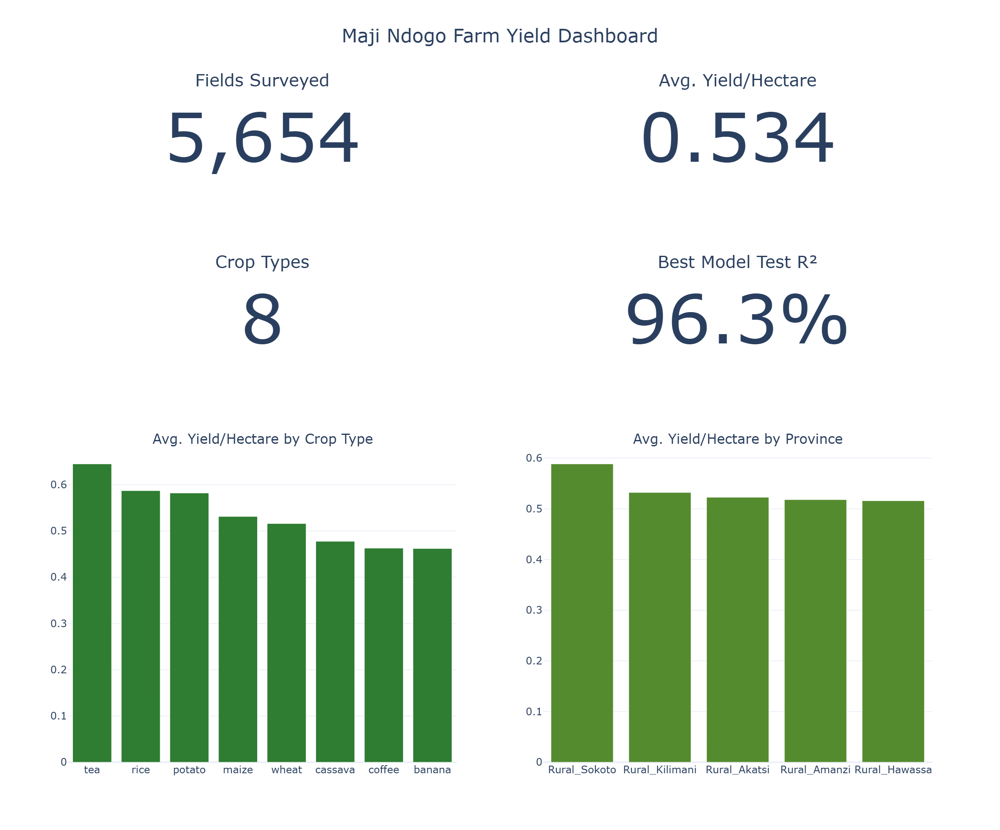
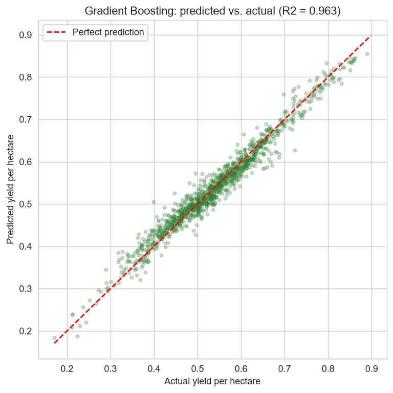
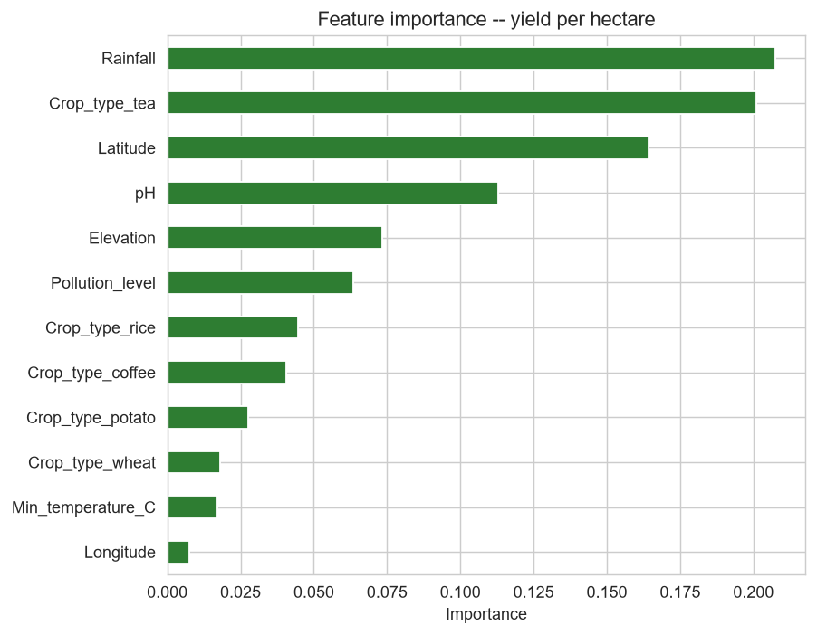

# 🌾 Maji Ndogo Farm Yield Prediction

**Regression modeling of crop yield per hectare from geographic, weather, and soil data — with two real data-quality bugs found and fixed before any model was trained**

> Interactive dashboard: [dashboard/farm_yield_dashboard.html](dashboard/farm_yield_dashboard.html)

---

## Problem

5,654 agricultural fields across 5 provinces, 8 crop types, with geographic, weather, soil, and farm-management data. The obvious modeling target — a column literally named `Annual_yield` — turns out to be the wrong one to predict (see below). This project finds the right target, engineers a clean feature set, and builds a yield-prediction model that explains which environmental factors actually drive yield.

**Research questions:**
- What does "yield" actually mean in this dataset, and is the most obviously-named column the right one to model?
- Which environmental factors (soil, weather, pollution, geography) correlate with yield?
- Can yield per hectare be predicted from field characteristics, and how well?

---

## Dataset

Source: `Maji_Ndogo_farm_survey_small.db` (4 linked tables: geographic, weather, soil/crop, farm-management features — 5,654 fields) + `Weather_Station_Dataset.zip` (1,843 free-text weather-station messages).

---

## Two real bugs found before modeling

1. **`Crop_type` and `Annual_yield` are swapped in the source schema.** The column labeled `Crop_type` held continuous numbers; the column labeled `Annual_yield` held crop-name strings (with typos: "wheatn", "teaa", "cassaval"). Verified and fixed in [`notebooks/01_data_cleaning.ipynb`](notebooks/01_data_cleaning.ipynb).
2. **`Annual_yield` is not a usable modeling target.** It correlates at r=0.95 with `Plot_size` — it's just total farm output, which scales with farm size almost by definition. The `Standard_yield` column, despite its name suggesting a fixed benchmark, turns out to be **exactly** `Annual_yield / Plot_size` (r=1.0, verified in [`notebooks/02_exploratory_analysis.ipynb`](notebooks/02_exploratory_analysis.ipynb)) — the real, size-independent yield-per-hectare rate, and the correct target.

Building a yield model on the obviously-named `Annual_yield` column would have produced a model that mostly just predicts farm size.

---

## Methods

| Layer | What it does | Files |
|---|---|---|
| **Cleaning** | Fix the schema swap, clean crop-name typos, join 4 tables, parse 10 distinct weather-message text templates (English + Chinese) via regex, cross-validate against clean data | [`notebooks/01_data_cleaning.ipynb`](notebooks/01_data_cleaning.ipynb) |
| **EDA** | Identify the correct modeling target, yield by crop/province/soil type, environmental correlation analysis | [`notebooks/02_exploratory_analysis.ipynb`](notebooks/02_exploratory_analysis.ipynb) |
| **ML** | 4 regression models (Linear, Ridge, Random Forest, Gradient Boosting) predicting yield per hectare | [`notebooks/03_machine_learning.ipynb`](notebooks/03_machine_learning.ipynb) |
| **Dashboard** | Self-contained interactive HTML dashboard | [`dashboard/farm_yield_dashboard.html`](dashboard/farm_yield_dashboard.html) |

---

## Results

- **Tea has the highest yield per hectare (0.645), banana and coffee the lowest (~0.46).**
- **Sokoto has the highest average yield per hectare (0.588)** despite being the worst-served province in the companion [water-access-analytics](https://github.com/Valerie-komen/Maji-Ndogo-Water-Access-Analytics) project — two different datasets, no link between them is claimed.
- **Volcanic and loamy soils out-yield sandy, rocky, and peaty soils.**
- **Pollution level (r=-0.29) and pH (r=-0.20) are the strongest single environmental correlates of yield**; rainfall and temperature show almost no linear relationship alone.
- **Gradient Boosting predicts yield per hectare at test R²=0.963, cross-validated R²=0.957 (±0.003)** — strong and stable, though flagged honestly in the notebook as unusually clean for real agricultural data, more consistent with this being a course-generated dataset than field-collected noise.



---

## Machine Learning

Target: `Standard_yield` (yield per hectare — see "two bugs" above for why). Features: geographic (elevation, lat/long, slope, province), weather (rainfall, temperature), soil (fertility, type, pH), pollution level, and crop type. `Plot_size` and `Annual_yield` are deliberately excluded from features since the target is defined from them.

| Model | Test R² | CV R² (5-fold) | Test RMSE |
|---|---|---|---|
| Linear Regression | 0.655 | 0.628 | 0.068 |
| Ridge Regression | 0.655 | 0.628 | 0.068 |
| Random Forest | 0.914 | 0.915 | 0.034 |
| **Gradient Boosting** | **0.963** | **0.957** | **0.022** |

Tree-based models substantially outperform linear ones — the real relationship between these features and yield is meaningfully non-linear. Top features (rainfall, tea as a crop type, latitude, pH, elevation, pollution level) are agronomically sensible and stable across model types.




---

## A text-parsing exercise, done properly

`Weather_station_data.csv` holds free-text sensor messages in a mix of English and Chinese templates. A first regex pass matched only 40% of messages — rather than accept that, the unmatched messages were inspected directly, which revealed **10 distinct templates** (not 4): 3 metrics (temperature, rainfall, pollution) × 3-4 phrasings each. Full coverage (100%) achieved, and the parsed rainfall values were cross-validated against the clean field-level data — they agree closely (e.g. station 2: 1,691mm parsed vs. 1,706mm from clean data).

---

## Installation

```bash
git clone https://github.com/Valerie-komen/Maji-Ndogo-Farm-Yield-Prediction.git
cd Maji-Ndogo-Farm-Yield-Prediction
pip install -r requirements.txt
```

## Reproducibility

1. **Data cleaning:** [`notebooks/01_data_cleaning.ipynb`](notebooks/01_data_cleaning.ipynb) → `data/cleaned_farm_data.csv`.
2. **EDA:** [`notebooks/02_exploratory_analysis.ipynb`](notebooks/02_exploratory_analysis.ipynb).
3. **ML:** [`notebooks/03_machine_learning.ipynb`](notebooks/03_machine_learning.ipynb).
4. **Dashboard:** open [`dashboard/farm_yield_dashboard.html`](dashboard/farm_yield_dashboard.html) directly in a browser.

**Note on raw data:** the source `.db` and weather-station `.zip` are ALX coursework materials and aren't committed here — `data/cleaned_farm_data.csv` is the fully reconciled, analysis-ready output.

All notebook outputs in this repository are real, executed results.

---

## Repository Structure

```
Maji-Ndogo-Farm-Yield-Prediction/
├── README.md
├── requirements.txt
├── data/
│   ├── cleaned_farm_data.csv
│   └── parsed_weather_messages.csv
├── notebooks/
│   ├── 01_data_cleaning.ipynb
│   ├── 02_exploratory_analysis.ipynb
│   └── 03_machine_learning.ipynb
├── dashboard/
│   └── farm_yield_dashboard.html
└── images/
```

---

## Limitations

- No data on farming practices, seed variety, or irrigation — all plausibly matter more than what's available here, and their absence is part of why the model, despite its high R², shouldn't be read as a complete causal explanation of yield.
- The unusually high R² likely reflects this being a course-generated dataset rather than noisy real-world field data — disclosed rather than presented as a realistic accuracy expectation for production agricultural modeling.
- Weather-station text messages only cover 5 stations mapped to specific fields; not every field has a directly-matched station message.

---

*Questions or feedback? Feel free to open an issue or connect with me on LinkedIn.*
